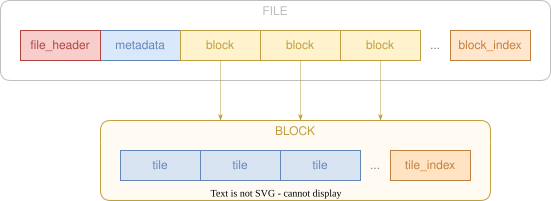
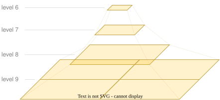
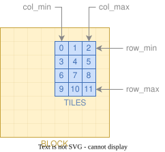

<!-- Generated by scripts/sync-spec.ts from versatiles-org/versatiles-spec — do not edit. -->

# VersaTiles Container Format Specification v2.1

> [!NOTE]
> This page is generated from the canonical specification in
> [versatiles-spec](https://github.com/versatiles-org/versatiles-spec). Report problems and propose changes there;
> edits made here are overwritten.
>
> Source: [`v02/readme.md`](https://github.com/versatiles-org/versatiles-spec/blob/main/v02/readme.md).

## 1. Introduction

This document defines the VersaTiles Container Format v2.1, which describes the structure and encoding mechanisms for efficiently storing large numbers of map tiles.

## 2. General Guidelines

- **Byte order:** All numeric values are encoded in big-endian byte order.
- **Tile organisation:** Tiles are organised according to the XYZ scheme, with the origin (x=0, y=0) at the top left (northwest) corner.
- **Zoom levels:** Valid zoom levels range from `0` to `30`, in line with [TileJSON 3.0](https://github.com/mapbox/tilejson-spec/tree/master/3.0.0). This applies to the zoom levels in the [File Header](#31-file-header) and in the [Block Index](#34-block-index).
- **Unknown values:** Values not listed in this specification are reserved for future versions. A reader encountering a reserved value must reject the container. It must not substitute a default, and it must not pass the affected data through unchanged.

## 3. File Structure

The VersaTiles container format consists of four main components:

1. **[File Header](#31-file-header):** Introduces the container file, details its global properties, and indicates the locations of the [Metadata](#32-metadata-chunk) and [Block Index](#34-block-index).
2. **[Metadata](#32-metadata-chunk):** Provides detailed information about the tileset, including attribution and layer definitions.
3. **[Blocks](#33-blocks):** Aggregates tiles into larger units (Blocks) for efficient storage and access, each containing [**Tile Blobs**](#331-tile-blobs) and [**Tile Index**](#332-tile-index).
4. **[Block Index](#34-block-index):** Acts as a parent directory for all blocks within the file.

|                     File Format                     |
| :-------------------------------------------------: |
|  |

### 3.1. File Header

- **Length:** 66 bytes.
- **Position:** At the beginning of the file.
- **Purpose:** Outlines essential file properties and indicates subsequent section locations.
- All offsets are relative to the beginning of the file.
- The minimum zoom level must be less than or equal to the maximum zoom level.
- The bounding box values must lie within `-180` to `180` degrees longitude and `-90` to `90` degrees latitude. The minimum must be less than or equal to the maximum for both axes, so bounding boxes crossing the antimeridian are not supported. A tileset that crosses the antimeridian should use the full longitude range (`-180` to `180`).

| Offset | Length |  Type  | Description                              |
| -----: | -----: | :----: | ---------------------------------------- |
|      0 |     14 | string | File identifier (`"versatiles_v02"`)     |
|     14 |      1 |   u8   | `tile_format` value                      |
|     15 |      1 |   u8   | `precompression` value                   |
|     16 |      1 |   u8   | minimum zoom level                       |
|     17 |      1 |   u8   | maximum zoom level                       |
|     18 |      4 |  i32   | bbox min x (10⁷ × lon)                   |
|     22 |      4 |  i32   | bbox min y (10⁷ × lat)                   |
|     26 |      4 |  i32   | bbox max x (10⁷ × lon)                   |
|     30 |      4 |  i32   | bbox max y (10⁷ × lat)                   |
|     34 |      8 |  u64   | offset of [Metadata](#32-metadata-chunk) |
|     42 |      8 |  u64   | length of [Metadata](#32-metadata-chunk) |
|     50 |      8 |  u64   | offset of [Block Index](#34-block-index) |
|     58 |      8 |  u64   | length of [Block Index](#34-block-index) |

#### 3.1.1. Value `tile_format`

| Value hex | Value dec |   Type   | MIME type                            |
| --------: | --------: | :------: | ------------------------------------ |
|    `0x00` |       `0` |   bin    | _application/octet-stream_           |
|    `0x10` |      `16` |   png    | _image/png_                          |
|    `0x11` |      `17` |   jpg    | _image/jpeg_                         |
|    `0x12` |      `18` |   webp   | _image/webp_                         |
|    `0x13` |      `19` |   avif   | _image/avif_                         |
|    `0x14` |      `20` |   svg    | _image/svg+xml_                      |
|    `0x20` |      `32` |   mvt    | _application/vnd.mapbox-vector-tile_ |
|    `0x21` |      `33` | geojson  | _application/geo+json_               |
|    `0x22` |      `34` | topojson | _application/topo+json_              |
|    `0x23` |      `35` |   json   | _application/json_                   |
|    `0x24` |      `36` |   mlt    | _application/vnd.maplibre-tile_      |

- Values not listed above are reserved, see [General Guidelines](#2-general-guidelines).
- `0x20` ([MVT](#4-glossary)) was named `pbf` with the MIME type _application/x-protobuf_ in earlier versions of this specification. The value itself is unchanged. Implementations should accept `pbf` as an alias for `mvt`.
- `0x24` ([MLT](#4-glossary)): MapLibre has not registered a media type for MLT yet. _application/vnd.maplibre-tile_ is the type used by MapLibre tools and may change if an official type is registered. Some tools use the older _application/vnd.maplibre-vector-tile_.
- An MLT tile may contain layers of different MLT format versions. The `tile_format` value does not distinguish between them; readers must handle MLT versioning as defined by the MLT specification.

#### 3.1.2. Value `precompression`

[Metadata](#32-metadata-chunk) and all [Tile Blobs](#331-tile-blobs) are pre-compressed with:

| Value | Method       |
| ----- | ------------ |
| `0`   | Uncompressed |
| `1`   | gzip         |
| `2`   | Brotli       |
| `3`   | Zstandard    |

- Values not listed above are reserved, see [General Guidelines](#2-general-guidelines).
- The `precompression` value is independent of the `tile_format`. This includes formats with internal compression such as MLT, where uncompressed storage (`0`) is valid but an additional precompression usually still reduces the size.
- This flag applies only to the [Metadata](#32-metadata-chunk) and the [Tile Blobs](#331-tile-blobs). The [Tile Index](#332-tile-index) and the [Block Index](#34-block-index) are always Brotli compressed, regardless of this value.

### 3.2. Metadata Chunk

- **Content:** Encapsulates `tiles.json`, detailing tileset metadata, as defined by [TileJSON 3.0](https://github.com/mapbox/tilejson-spec/tree/master/3.0.0) and the [VersaTiles Extended TileJSON](https://docs.versatiles.org/compendium/specification_extended_tilejson.html) specification.
- **Encoding:** UTF-8.
- **Compression:** Defined by the [`precompression`](#312-value-precompression) flag in the [File Header](#31-file-header).
- **Vector tiles:** For the vector tile formats `mvt` and `mlt`, `tiles.json` should contain `vector_layers` describing the layers of the tiles.
- **Note:** The absence of Metadata is indicated by zero offsets and lengths in the [File Header](#31-file-header).

### 3.3. Blocks

- **Structure:** Blocks act as aggregators for up to 256×256 tiles.
- **Zoom Levels:** Individual Blocks can span entire zoom levels (0-8). Higher zoom levels (>8) may require multiple Blocks.
- Maximum number of Blocks per zoom level: `pow(4, max(0, level - 8))`.

|                   Blocks per level                    |
| :---------------------------------------------------: |
|  |

- Each Block contains concatenated [Tile Blobs](#331-tile-blobs) and ends with a [Tile Index](#332-tile-index).
- Neither the [Tile Blobs](#331-tile-blobs) in a Block nor the Blocks in the file need to follow any particular order.

#### 3.3.1. Tile Blobs

- Tile Blobs are concatenated binary data, each containing one tile. All tiles have the same format and the same precompression.
- **Format:** Each Tile Blob has the same file format, determined by the [`tile_format`](#311-value-tile_format) code in the [File Header](#31-file-header).
- **Compression:** Each Tile Blob is compressed according to the [`precompression`](#312-value-precompression) flag in the [File Header](#31-file-header).

#### 3.3.2. Tile Index

- **Compression:** Brotli, regardless of the [`precompression`](#312-value-precompression) flag.
- **Purpose:** Maps the coordinates of tiles within a block to their respective binary position and length.
- **Position:** The Tile Index directly follows the [Tile Blobs](#331-tile-blobs), i.e. it starts at the offset of the Block plus the length of the Tile Blobs (both specified in [Block Index](#34-block-index)).
- **Entries:** After decompression, the Tile Index contains exactly `(col_max - col_min + 1) * (row_max - row_min + 1)` entries of 12 bytes each.
- Tiles are ordered horizontally, then vertically
- `index = (row - row_min) * (col_max - col_min + 1) + (col - col_min)`
- (`col_min`, `row_min`, `col_max`, `row_max` are specified in [Block Index](#34-block-index))
- Identical [Tile Blobs](#331-tile-blobs) can be stored once and referenced multiple times to save storage space.
- If a tile does not exist, the length of the Tile Blob is `0`. Writers should set its offset to `0` as well; readers must ignore the offset of entries with length `0`.
- The offsets of [Tile Blobs](#331-tile-blobs) are relative to the beginning of the Block. Since the Tile Blobs start at the beginning of the Block, the smallest offset should always be `0`, regardless of the order of the entries in the Tile Index.

| Offset | Length | Type | Description                  |
| ------ | -----: | :--: | ---------------------------- |
| 12*i   |      8 | u64  | offset of Tile Blob in Block |
| 12*i+8 |      4 | u32  | length of Tile Blob          |

|                 index of Tile Blobs                 |
| :-------------------------------------------------: |
|  |

### 3.4. Block Index

- **Compression:** Brotli, regardless of the [`precompression`](#312-value-precompression) flag.
- **Function:** Provides a directory for locating [Blocks](#33-blocks) within the container file.
- Empty Blocks are not stored.
- Each Block, identified by `level`, `column` and `row`, must appear at most once in the Block Index. Readers should reject a Block Index containing duplicate entries.
- Each 33-byte entry within the Block Index is structured as follows:

|    Offset | Length | Type | Description                             |
| --------: | -----: | :--: | --------------------------------------- |
|  0 + 33*i |      1 |  u8  | `level`                                 |
|  1 + 33*i |      4 | u32  | `column`/256                            |
|  5 + 33*i |      4 | u32  | `row`/256                               |
|  9 + 33*i |      1 |  u8  | `col_min` (0..255)                      |
| 10 + 33*i |      1 |  u8  | `row_min` (0..255)                      |
| 11 + 33*i |      1 |  u8  | `col_max` (0..255)                      |
| 12 + 33*i |      1 |  u8  | `row_max` (0..255)                      |
| 13 + 33*i |      8 | u64  | offset of Block in file                 |
| 21 + 33*i |      8 | u64  | length of [Tile Blobs](#331-tile-blobs) |
| 29 + 33*i |      4 | u32  | length of [Tile Index](#332-tile-index) |

- `col_min` must be less than or equal to `col_max`, and `row_min` must be less than or equal to `row_max`. Readers must reject a Block Index entry violating this.
- Since a Block consists only of [Tile Blobs](#331-tile-blobs) appended by a [Tile Index](#332-tile-index), the length of Block must be the sum of the lengths of the [Tile Blobs](#331-tile-blobs) and the [Tile Index](#332-tile-index).
- Note: To efficiently find the Block containing the tile you are looking for, use a data structure such as a "map", "dictionary" or "associative array" and fill it with the data from the Block Index.

## 4. Glossary

- **Blob:** A chunk of binary data. [Object storage on Wikipedia](https://en.wikipedia.org/wiki/Object_storage)
- **Block:** A composite unit containing up to 256×256 tiles.
- **Brotli:** A compression algorithm known for its efficiency and performance. It provides better compression than gzip. [Brotli on Wikipedia](https://en.wikipedia.org/wiki/Brotli)
- **gzip:** A widely supported compression algorithm based on DEFLATE. [gzip on Wikipedia](https://en.wikipedia.org/wiki/Gzip)
- **MLT:** MapLibre Tile, a column-oriented vector tile format developed by MapLibre. [MapLibre Tile Specification](https://maplibre.org/maplibre-tile-spec/)
- **MVT:** Mapbox Vector Tile, a Protocol Buffers based vector tile format. Formerly referred to as `pbf` in this specification. [Mapbox Vector Tile Specification](https://github.com/mapbox/vector-tile-spec)
- **Tile:** A square geographic area at a given zoom level containing map information as an image or as vector data.
- **TileJSON:** A JSON format describing a tileset, e.g. its zoom levels, bounding box, attribution and vector layers. [TileJSON 3.0](https://github.com/mapbox/tilejson-spec/tree/master/3.0.0)
- **XYZ:** A tiling scheme that addresses tiles by zoom level `z`, column `x` and row `y`, with the origin at the top left (northwest) corner. [Tiled web map on Wikipedia](https://en.wikipedia.org/wiki/Tiled_web_map)
- **Zstandard:** A compression algorithm, commonly abbreviated as `zstd`, that reaches compression ratios comparable to Brotli at significantly higher compression and decompression speeds. [Zstandard on Wikipedia](https://en.wikipedia.org/wiki/Zstd)
